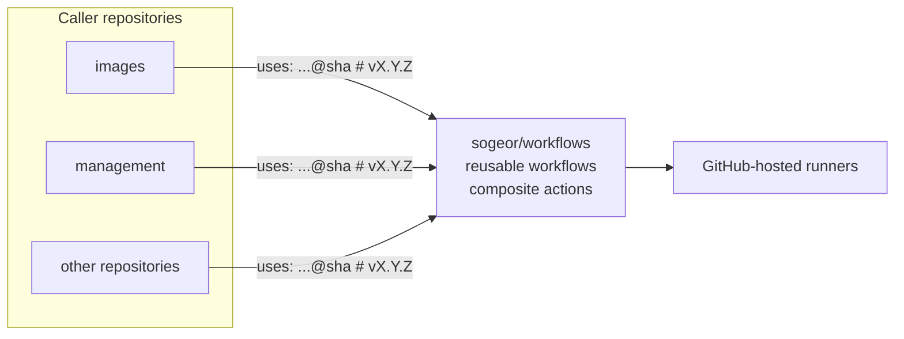

# workflows

Reusable GitHub Actions workflows and composite actions for the sogeor platform.

[](https://github.com/sogeor/workflows/actions/workflows/validate.yml)
[](https://github.com/sogeor/workflows/actions/workflows/docs.yml)
[](https://scorecard.dev/viewer/?uri=github.com/sogeor/workflows)
[](LICENSE)

## Overview

- One place for CI logic shared by every repository of the [sogeor](https://github.com/sogeor) organization.
- **Secure by default:** minimal `permissions`, `persist-credentials: false`, actions pinned by full SHA,
  tool downloads verified by SHA-256, inputs passed to shell only through `env:`.
- **Exact versions:** callers pin a release by full commit SHA with the tag in a comment; Renovate updates it.
- **Tested:** `self-test` calls every workflow and action on fixtures.



## Quick start

```yaml
jobs:
  docs:
    uses: sogeor/workflows/.github/workflows/docs.yml@<full-sha> # vX.Y.Z
```

The first workflows arrive with release `v0.1.0`; see [Getting started](docs/getting-started.md).

## Documentation

| Page | What is inside |
|---|---|
| [Overview](docs/index.md) | Purpose, contents, place in the platform |
| [Getting started](docs/getting-started.md) | Calling a workflow from your repository |
| [Repository setup](docs/setup.md) | GitHub settings for this repository and for callers |
| [Configuration](docs/configuration.md) | Every input, secret and output |
| [Usage](docs/usage.md) | Typical calls |
| [Operations](docs/operations.md) | Releases, updates, rollback |
| [Architecture](docs/architecture.md) | Structure, interface contract, versioning |
| [Security](docs/security.md) | Guarantees, limits, assurance case |
| [Troubleshooting](docs/troubleshooting.md) | Symptoms, causes and fixes |
| [Reference](docs/reference/workflows.md) | All workflows and actions |
| [Decisions](docs/adr/index.md) | Architecture decision records |

Preview locally: `pip install --require-hashes -r .github/requirements-docs.txt && mkdocs serve`.

## Versions

| Component | Version |
|---|---|
| Runner image | `ubuntu-24.04` |
| actions/checkout | v7.0.1 |
| actions/upload-artifact | v7.0.2 |
| github/codeql-action | v4.38.3 |
| ossf/scorecard-action | v2.4.4 |
| DavidAnson/markdownlint-cli2-action | v24.2.0 |
| lycheeverse/lychee-action | v2.9.0 |
| actionlint | 1.7.12 |
| gitleaks | 8.30.1 |
| zizmor | 1.30.1 |
| yamllint | 1.38.0 |
| mkdocs-material | 9.7.7 |

## Contributing

See [CONTRIBUTING.md](CONTRIBUTING.md), [GOVERNANCE.md](GOVERNANCE.md) and [CODE_OF_CONDUCT.md](CODE_OF_CONDUCT.md).

## Security

Report vulnerabilities privately as described in [SECURITY.md](SECURITY.md).

## License

[Apache-2.0](LICENSE)
