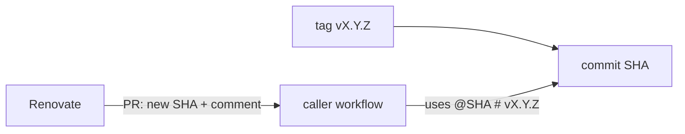

# Architecture

## Layout

```text
.github/workflows/   reusable workflows (on: workflow_call) and this repository's own CI
actions/<name>/      composite actions (action.yml)
tests/fixtures/      inputs for self-test
docs/                documentation
```

## Interface contract

- A reusable workflow declares every input, secret and output with a description.
- Secrets are passed explicitly by the caller; no workflow requires `secrets: inherit`.
- Inputs reach shell code only through `env:`.
- Breaking interface changes require a new major version.

## Versioning

Exact SemVer tags `vX.Y.Z`, called by full commit SHA; see [ADR 0002](adr/0002-versioning-and-pinning.md).


