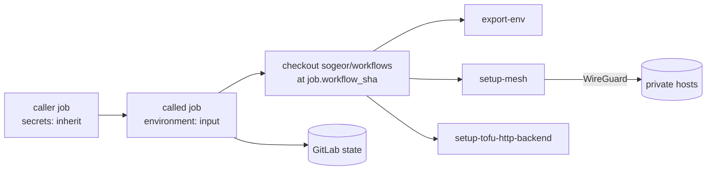
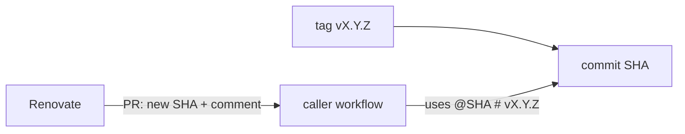

# Architecture

## Layout

```text
.github/workflows/   reusable workflows (on: workflow_call) and this repository's own CI
actions/<name>/      composite actions (action.yml)
tests/fixtures/      inputs for self-test
docs/                documentation
```

## Infrastructure jobs



See [ADR 0003](adr/0003-environment-scoped-credentials.md), [ADR 0004](adr/0004-mesh-access-for-ci.md),
[ADR 0005](adr/0005-shared-actions-from-the-same-commit.md).

## Interface contract

- A reusable workflow declares every input, secret and output with a description.
- Scanning workflows take secrets explicitly; infrastructure workflows read the caller's Environment
  (`secrets: inherit`) by documented names.
- Inputs reach shell code only through `env:`.
- Breaking interface changes require a new major version.

## Versioning

Exact SemVer tags `vX.Y.Z`, called by full commit SHA; see [ADR 0002](adr/0002-versioning-and-pinning.md).


